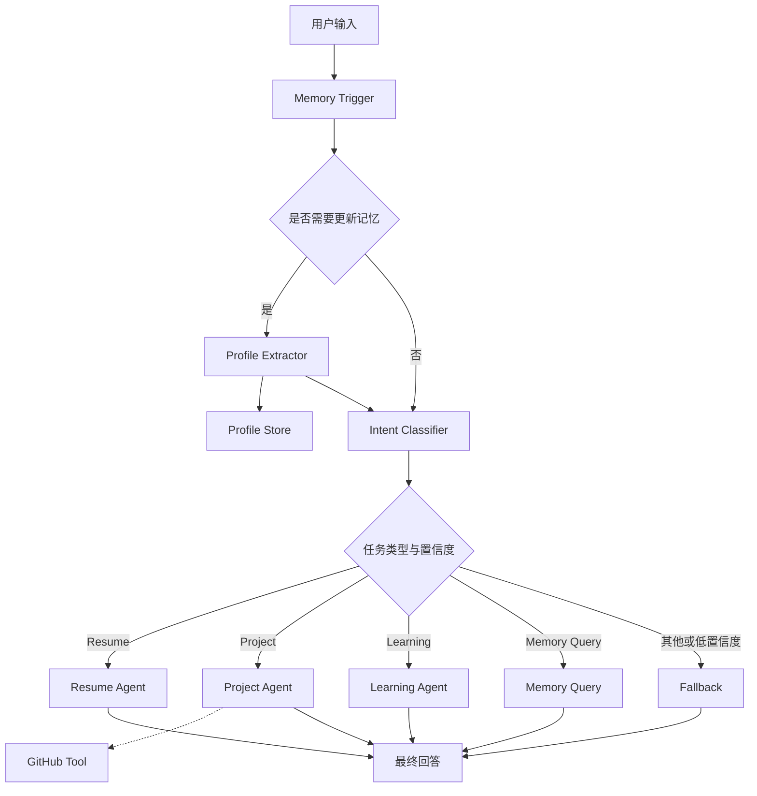

# Multi-Task AI Agent

基于 LangGraph 的多任务智能助手，支持意图识别、任务路由、用户长期记忆管理、工具调用及自动化评估。

## 1. 项目简介

本项目基于 Python、LangGraph 和大语言模型构建，面向简历辅助、项目分析、技术学习及个人信息记忆等场景。

系统通过 Intent Classifier 识别用户需求，并利用 LangGraph StateGraph 的条件路由机制，将请求分发到对应的任务节点。同时设计用户资料提取与长期记忆机制，使系统能够在不同会话中复用已保存的用户信息。

项目重点探索多任务 Agent 工作流编排、结构化输出、状态管理、记忆机制、异常处理及自动化评估。

## 2. 核心功能

| 功能模块 | 实现内容 |
|---|---|
| 意图识别 | 基于 LLM 对用户请求进行分类，输出任务类型与置信度 |
| 动态任务路由 | 通过 LangGraph 条件边分发到不同业务节点 |
| 多任务处理 | 支持简历辅助、项目分析、技术学习、记忆查询及兜底回答 |
| 长期记忆 | 自动识别需要保存的用户信息，提取并更新用户资料 |
| 会话状态 | 使用 LangGraph Checkpointer 管理会话状态 |
| 工具调用 | 在项目分析节点中集成 GitHub 工具 |
| 结构化输出 | 使用 Pydantic 校验模型输出 |
| 异常处理 | 对解析错误、校验失败和部分调用异常进行处理或降级 |
| 自动化评估 | 使用独立测试集评估意图识别效果，并生成评估报告 |

## 3. 技术栈

- Python 3.10
- LangGraph：工作流编排、状态管理与条件路由
- LangChain：消息对象与大模型调用相关组件
- Pydantic：结构化数据校验
- LLM API：意图识别、信息提取与任务回答
- JSON：用户资料及评估结果存储
- Python unittest：自动化测试
- uv：Python 项目依赖管理

## 4. 系统架构



### 4.1 意图识别与任务路由

系统通过独立的 Intent Classifier 识别用户输入，得到任务类型和分类置信度。

支持以下五类任务：

- `resume`：简历相关辅助
- `project`：项目分析与技术建议
- `learning`：技术学习指导
- `memory_query`：历史用户信息查询
- `fallback`：未匹配任务或低置信度请求处理

通过 LangGraph 的 Conditional Edges，根据分类结果决定执行路径。

### 4.2 长期记忆机制

系统将会话状态与用户长期资料分开管理。

短期会话状态由 LangGraph State 和 Checkpointer 管理，用于维持当前会话的上下文。

长期用户资料由 Profile Store 管理，支持提取、合并、保存和读取用户信息。

当 Memory Trigger 判断用户输入包含值得保存的信息时，系统调用 Profile Extractor，使用结构化输出提取相关字段，并更新用户资料。

### 4.3 异常处理

项目对关键 LLM 调用和数据解析过程进行异常处理，包括：

- 非法 JSON 输出
- Pydantic Schema 校验失败
- LLM 调用失败
- 部分可重试的网络或服务错误
- 用户资料保存失败
- 意图识别异常时的 fallback 降级

通过统一异常类型和调用封装，减少异常向业务节点扩散。

## 5. 项目目录

```text
project_root/
├── main.py                 # CLI 演示入口
├── evaluate_agent.py       # Agent 评估脚本
├── run_all_tests.py        # 自动化测试入口
├── pyproject.toml          # 项目依赖配置
├── langgraph.json          # LangGraph 配置
├── src/
│   └── agent/
│       ├── graph.py        # LangGraph 工作流定义
│       ├── state.py        # State 定义
│       ├── llm.py          # LLM 初始化
│       ├── nodes/          # Agent 业务节点
│       ├── prompts/        # Prompt 模板
│       ├── schemas/        # Pydantic Schema
│       ├── memory/         # 用户资料存储
│       ├── tools/          # GitHub 工具
│       └── utils/          # 日志、异常、解析及调用工具
├── tests/                  # 自动化测试
└── eval/                   # 评估数据集与报告
```

## 6. 快速开始

### 6.1 环境要求

推荐 Python 3.10。

项目使用 `pyproject.toml` 和 `uv.lock` 管理依赖。

```bash
uv sync
```

按照 `.env.example` 创建 `.env` 文件，并填写项目所需的大模型 API 配置。

### 6.2 运行 CLI Demo

```bash
python main.py
```

示例：

```text
User: 什么是 LangGraph 的 State？

Agent: State 可以理解为工作流中的共享状态，
不同节点读取状态并返回更新，
LangGraph 根据状态更新和路由规则推进执行。
```

支持输入 `new` 开始新会话，输入 `exit` 退出程序。

### 6.3 自动化测试

```bash
python run_all_tests.py
```

当前测试结果：

```text
Ran 27 tests

OK
```

## 7. 测试与评估

### 7.1 自动化测试

项目使用 Python unittest 测试关键功能。

| 测试模块 | 用例数量 |
|---|---:|
| Intent Classifier | 6 |
| Graph Routing | 5 |
| Memory | 6 |
| Profile Extractor | 4 |
| Memory Pipeline | 3 |
| Checkpoint Memory | 3 |
| 总计 | 27 |

最近一次测试结果：27/27 通过。

### 7.2 意图识别评估

项目构建了独立的意图分类评估数据集，并通过自动化脚本执行评估。

在已完成的 50 条样例评估中，分类正确率为 100%（50/50）。

评估报告记录数据集路径、数据集 SHA256、Prompt 版本及逐条预测结果等信息，便于结果追溯和不同实验之间的比较。

**说明：** 该准确率仅反映特定评估集上的测试表现，不代表真实环境中的泛化准确率。

## 8. 项目设计特点

**模块化工作流：** 将意图识别、记忆处理和任务回答拆分为独立节点，便于测试、维护和功能扩展。

**状态与长期记忆分离：** 区分会话执行状态和持久化用户资料，避免将两者混为同一概念。

**结构化输出校验：** 使用 Pydantic 验证关键 LLM 输出，降低格式异常对工作流的影响。

**可测试性：** 对分类、路由、记忆更新和异常场景分别设计测试用例，并使用独立评估数据集验证分类表现。

## 9. 后续优化方向

- 扩展意图识别评估数据集，提高边界场景覆盖率
- 增加完整工作流集成测试
- 优化任务节点的回答质量与工具调用策略
- 根据实际使用需求增加 Web 交互界面

## 10. 项目定位

本项目是一个面向 AI Agent 应用开发学习与实践的个人项目，重点在于掌握 LangGraph 工作流编排、多任务路由、LLM 结构化输出、用户记忆管理以及 Agent 测试评估方法。
